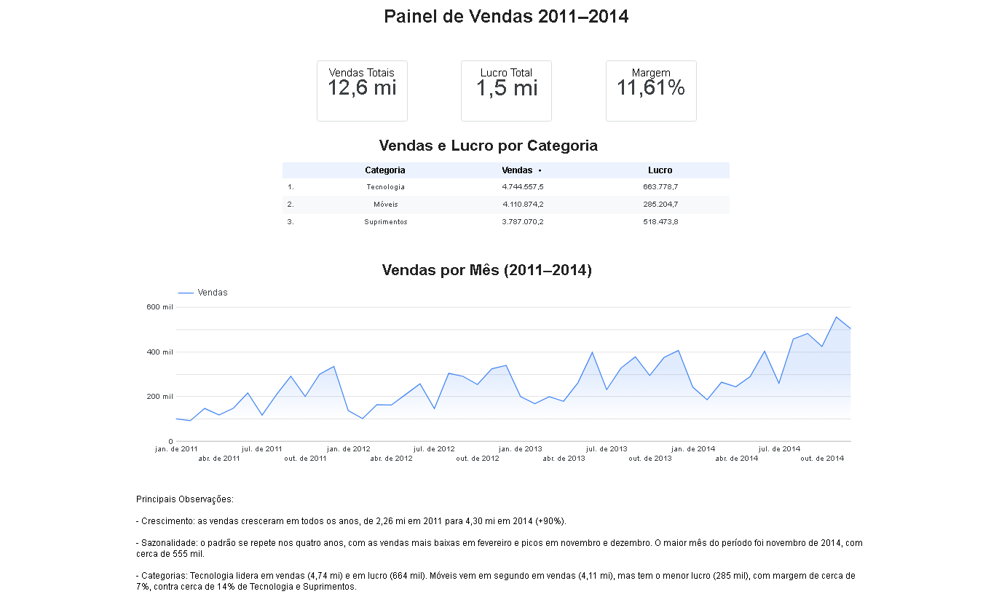

# Painel de Vendas 2011–2014 (Looker Studio)

**Relatório interativo:** https://datastudio.google.com/s/hPE0Qv6P014

## O que o painel mostra

- **Scorecards:** vendas totais, lucro total e margem geral do período.
- **Tabela:** vendas e lucro por categoria.
- **Série temporal:** vendas por mês, de janeiro de 2011 a dezembro de 2014.

## Base de dados

Arquivo: `data/dataset.xlsx` (51.290 linhas, 14 colunas, período de 01/01/2011 a 31/12/2014).

| Tipo | Colunas |
|---|---|
| Texto | ID_Pedido, ID_Cliente, Segmento, Regiao, Pais, Product ID, Categoria, SubCategoria, Prioridade |
| Data | Data_Pedido |
| Numérico | Total_Vendas, Quantidade, Desconto, Lucro |

Não há valores vazios em nenhuma coluna.

## Principais observações

Valores calculados diretamente na base e conferidos com o relatório.

- **Crescimento:** as vendas cresceram em todos os anos, de 2,26 mi em 2011 para 4,30 mi em 2014 (+90%).
- **Sazonalidade:** fevereiro é o mês mais fraco em todos os anos, com picos em novembro e dezembro. O maior mês foi novembro de 2014 (cerca de 555 mil).
- **Categorias:** Tecnologia lidera em vendas (4,74 mi) e em lucro (664 mil). Móveis é a segunda em vendas (4,11 mi), mas tem o menor lucro (285 mil) e margem de cerca de 7%, contra cerca de 14% de Tecnologia e Suprimentos.
- **Totais:** vendas de 12,64 mi, lucro de 1,47 mi e margem geral de 11,6%.

Estas observações descrevem o que aconteceu. Os dados não explicam o motivo, por exemplo, da margem menor em Móveis.

## Como foi feito

1. Conversão do `.xlsx` para Planilhas Google, usada como fonte de dados do relatório.
2. Campo calculado `Margem = SUM(Lucro) / SUM(Total_Vendas)`. A divisão é feita depois de somar, e não linha a linha, para ponderar corretamente pelo valor de cada venda.
3. Campo calculado `Categoria_Corrigida`, para exibir "Móveis" com acento:

```
CASE
  WHEN Categoria = "Moveis" THEN "Móveis"
  ELSE Categoria
END
```

4. Gráfico de série temporal com granularidade ano e mês, tabela por categoria e três scorecards.

## Limitações

- A base não informa a moeda dos valores.
- Há 9 linhas totalmente idênticas, que não foram removidas.
- A coluna `Regiao` tem 1.094 valores distintos e mistura estados e cidades, por isso não foi usada.
- Cada linha é um item de pedido, não um pedido: `ID_Pedido` tem 25.035 valores únicos em 51.290 linhas.
